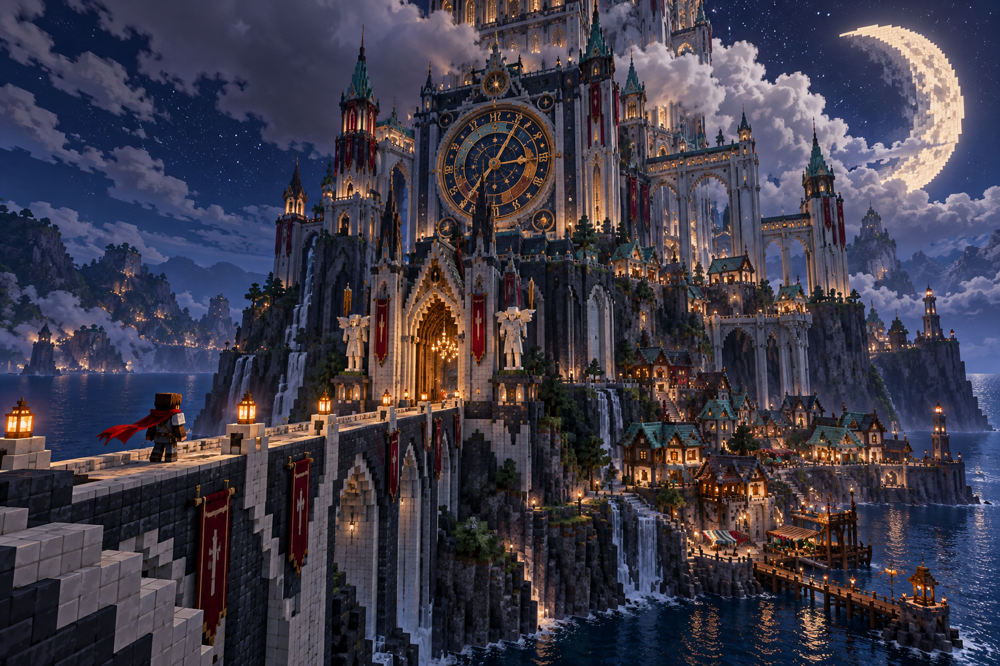

# Przegląd wizualny

## Wieża

## 01_peron

Koncepcja docelowej mapy:

Rzeczywista struktura z ZIP-a, przekrój:

## 02_ocean

Koncepcja docelowej mapy:

Rzeczywista struktura z ZIP-a, przekrój:

## 03_teatr

Koncepcja docelowej mapy:

Rzeczywista struktura z ZIP-a, przekrój:

## 04_ogrod

Koncepcja docelowej mapy:

Rzeczywista struktura z ZIP-a, przekrój:

## 05_serce

Koncepcja docelowej mapy:

Rzeczywista struktura z ZIP-a, przekrój:

## aktorka_bez_roli

Koncepcja postaci:

Dokładna geometria modelu:

## aniol_minuty

Koncepcja postaci:

Dokładna geometria modelu:

## ida

Koncepcja postaci:

Dokładna geometria modelu:

## konduktor

Koncepcja postaci:

Dokładna geometria modelu:

## nurek_dzwonowy

Koncepcja postaci:

Dokładna geometria modelu:

